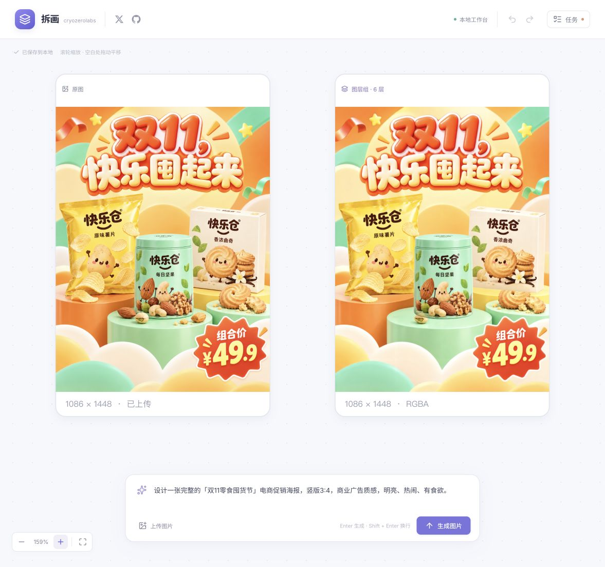
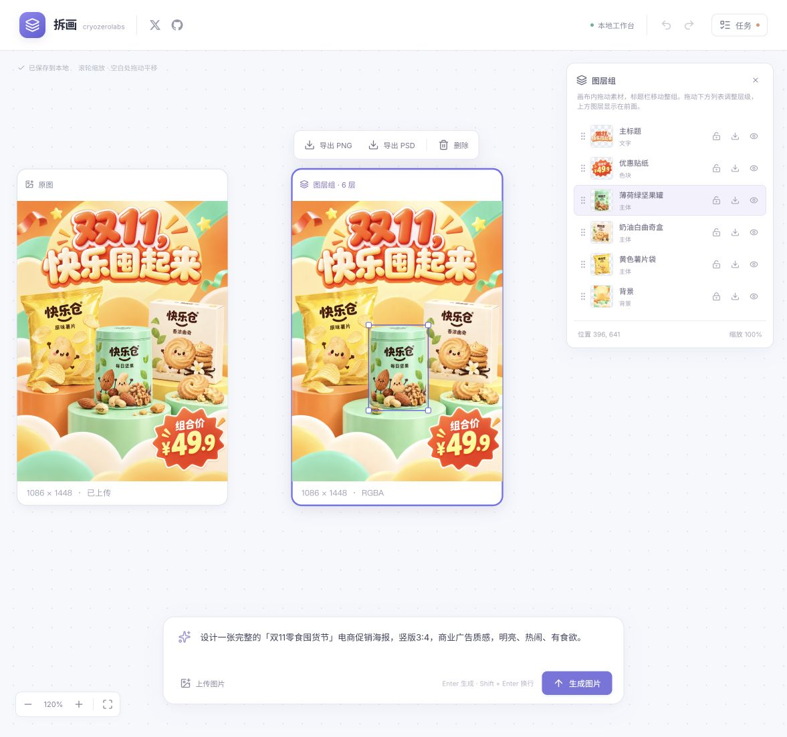

# 拆画

**拆画是一款开源的 AI 图层拆分与编辑工具：把生成或上传的成品图片拆成图层，在画布上调整，再导出成品或独立素材。**

很多 AI 生成图和现成海报，拿到手时只有一张 PNG 或 JPG。标题、商品、装饰和背景都在同一张图片里，想移动某个商品、提取优惠贴纸，通常需要重新抠图、修补背景，或者再生成一次。图片看起来已经完成了，后续修改和复用却仍然费工夫。这就是拆画要解决的问题。

拆画让这些元素重新成为独立的图片图层。例如一张「双11零食囤货节」海报，拆分后可以分别移动商品、缩放标题、隐藏优惠标签，也可以下载透明商品素材用于下一张图。它面向电商设计、活动海报制作和素材整理，重点是让已有图片更容易修改和复用。

**整个流程都在同一张画布上完成。**

1. **获得原图**：在底部输入需求，点击“生成图片”；也可以点击“上传图片”，或将 PNG、JPG、WebP 拖入画布。
2. **自动拆层**：点击画布上的原图，再点击“拆分图层”。系统自动制定拆层方案并生成图层，用户无需先猜层数。完成后在旁边新增图层组。

   

3. **直接编辑**：点击图层组，再点击画面中的某个素材，或右侧图层列表中的对应项，即可选中该图层。拖动选中的图层改变位置，拉动四角等比缩放；拖动右侧列表项调整层级，也可以隐藏、锁定或解锁图层。拖动标题栏移动整个图层组；背景默认锁定。支持撤销、重做和刷新恢复。

   

4. **按用途导出**：PNG 导出当前合成结果，PSD 保留独立像素图层，单个素材可导出原始尺寸的透明 PNG。

滚轮缩放画布，拖动空白处平移。编辑支持撤销、重做、对象删除和自动保存；刷新后恢复项目。项目与素材保存在本地 `.data/`，失败任务可在任务面板重试。

模型和供应商通过 `.env` 配置。文字保持图片图层；拆分粒度取决于模型输出，部分元素仍可能合在同一层。

## 启动

需要 Node.js 22.12 或更新版本。

```sh
git clone https://github.com/cryozerolabs/chaihua.git
cd chaihua
npm install
cp .env.example .env
```

配置说明见 [.env.example](.env.example)。完成本地配置后启动：

```sh
npm run dev
```

打开 [http://127.0.0.1:5173](http://127.0.0.1:5173)。修改 `.env` 后需要重启服务。
